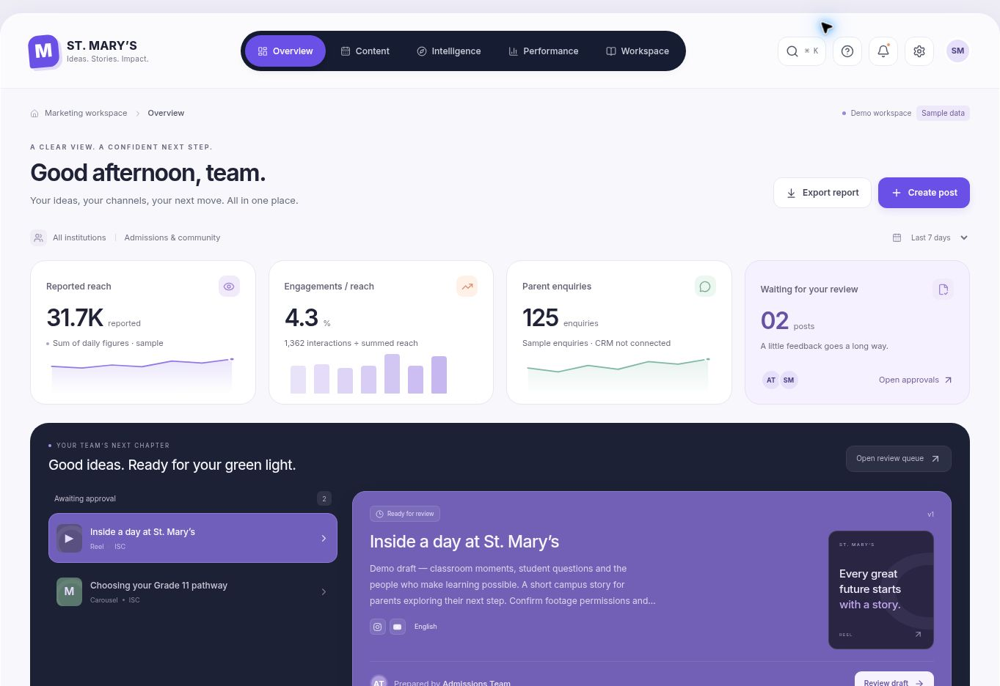
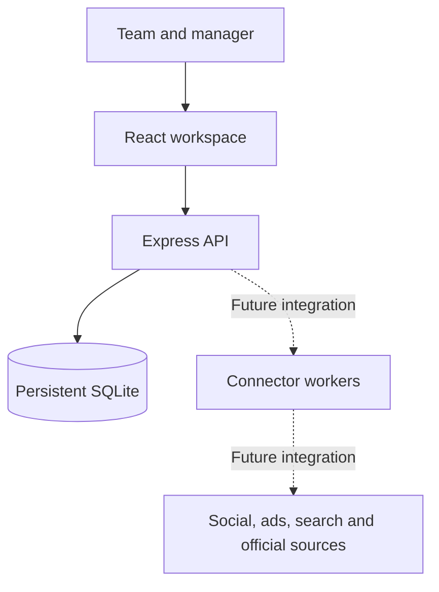

# St. Mary’s Marketing Workspace

A shared workspace for school content, manager approvals, research references, tasks and team knowledge. The application has a working React interface, an Express API and persistent SQLite storage.

**This release is a local content and approval system. It does not post to social networks, fetch external news, run advertisements or collect live analytics.** Planning a publication records an approved item in the local calendar; no worker sends it when that time arrives. Demo charts and campaign figures are explicitly illustrative.

## Interface preview

The interface adapts the supplied reference into a school workspace: light surfaces, a dark navigation bar, violet accents, a review list beside its selected content, and responsive layouts. All numbers shown below are sample data.



[See the full overview](docs/images/overview-1793779635887.jpg). The [validation notes](docs/VALIDATION.md) describe the checks performed and their limits.

## What works today

| Area         | Implemented behavior                                                                                                                    | Current boundary                                                                            |
| ------------ | --------------------------------------------------------------------------------------------------------------------------------------- | ------------------------------------------------------------------------------------------- |
| Content      | Create/edit drafts, platform selection, ownership, review requests, approval, rejection and change requests                             | Content previews are representations; no platform API is connected                          |
| Approval     | Server-enforced manager decisions, revision checks, approval reset after edits, audit records                                           | Approved items remain local until a publishing adapter is implemented                       |
| Planning     | Put approved content on a local calendar and remove it from the plan                                                                    | A planned time is not a live publication job                                                |
| Intelligence | Enter source-linked research briefs, save ideas, record manager verification and create a draft                                         | Manual entry works; automatic news collection and source extraction are future integrations |
| Watchlists   | Add/edit/delete competitor profiles and research-source URLs                                                                            | Records are labelled Manual review; saving a URL does not start a monitor                   |
| Workspace    | Task board/list, owners, priorities, due dates and statuses; categorized, searchable text documents                                     | No real-time document co-editing or Notion block editor                                     |
| Performance  | Explore sample charts/campaign tables and export available report data                                                                  | Production analytics start empty; no Meta, Google, social or CRM reports are fetched        |
| Accounts     | Password login, manager/contributor authorization, sessions, CSRF checks and manager-only team account creation in Settings and the API | No SSO, MFA, email invitations or password-reset flow in this release                       |

Turning a research brief into a draft uses its stored summary, suggested angle and source link. It does not call an AI model. Integration cards describe future connections; they are not connected services.

See [the roadmap](docs/ROADMAP.md) for the work needed to reach the full marketing automation goal, [the API reference](docs/API.md) for exact routes and permissions, and [UX decisions](docs/UX-RESEARCH.md) for the interface rationale.

## Requirements

- **Node.js 24** and npm. The backend uses Node's built-in `node:sqlite`; a separate SQLite server is not needed.
- An ordinary local disk or persistent container volume for the database.
- For a production browser deployment: an HTTPS domain and a reverse proxy in front of the Node service.
- Docker with the Compose plugin is optional. The Docker image also runs Node 24.

## Run the isolated demo

From the repository root:

```sh
nvm install
nvm use
npm ci
NODE_ENV=development DEMO_MODE=true DATABASE_PATH=./data/demo.sqlite \
  COOKIE_SECURE=false APP_ORIGIN=http://localhost:5173 \
  npm run dev -- --port 5173
```

If you do not use nvm, install Node 24 by your usual method and start with `npm ci`. The environment-variable syntax above is for a POSIX shell; set the same variables using your shell's syntax on other systems.

Open **http://localhost:5173**. Vite serves the frontend and proxies API calls to port 3001. The demo opens with a sample manager session and supports a demo-only role switch to try the contributor workflow. There is no shared demo password to reuse in production.

The demo includes illustrative posts, team records, research briefs and analytics. It does not seed student personal information, connect to school accounts or perform external actions. Edits persist in `data/demo.sqlite` across restarts. Treat a demo instance as a preview: anyone with access to it can enter the demo workspace.

Keep the demo on a development machine or private preview network. `npm run dev` binds the development services to the available interfaces; it is not the production command. The script reads `.env`, respects existing shell variables, and defaults to demo mode only when `DEMO_MODE` is unset. The explicit settings above select the demo database, HTTP cookie behavior and Vite port even if a production `.env` exists. Without an explicit database path, the development script chooses `data/demo.sqlite` in demo mode and `data/production.sqlite` otherwise.

**Demo and production use separate databases.** The server records a mode marker and refuses to open an existing demo database as production, or the reverse. Use a new `DATABASE_PATH`; do not promote or rename the demo database into production.

## Build and verify

```sh
npm run check
npm test
npm run build
npm run format:check
```

The tests cover authenticated sessions, CSRF and origin validation, contributor permissions, manager-only approval, approval invalidation after edits, stale revision rejection, local-only scheduling, source verification, repeat-safe brief-to-draft creation, resource validation and SQLite persistence. Tests create their own temporary or in-memory databases and do not require a real `.env` file or provider credentials.

`npm run build` creates `dist/`. The production Express service serves that build and the API from the same origin. GitHub Actions runs installation, checks, tests and the build on Node 24. The workflow does not deploy anything or access external accounts.

## Configure production

```sh
cp .env.example .env
chmod 600 .env
```

Edit `.env` before starting. Supply your real public HTTPS origin, a manager email and a unique strong bootstrap password. There is deliberately no default production password. Keep `.env` out of source control and restrict access to it.

| Variable                   | Purpose                                                                                                   |
| -------------------------- | --------------------------------------------------------------------------------------------------------- |
| `NODE_ENV=production`      | Production runtime; also makes secure cookies the backend default                                         |
| `DEMO_MODE=false`          | Starts an authenticated workspace without demonstration records                                           |
| `DATABASE_PATH`            | Persistent SQLite file; use `./data/production.sqlite` for native startup                                 |
| `PORT`                     | Backend port; defaults to 3001                                                                            |
| `BIND_ADDRESS`             | Native backend binding; the example uses host loopback                                                    |
| `APP_ORIGIN`               | Exact public origin, such as `https://marketing.school.edu.in`; no application path                       |
| `COOKIE_SECURE=true`       | Sends session cookies only over HTTPS                                                                     |
| `TRUST_PROXY=true`         | Trusts one reverse-proxy hop; use only with a trusted proxy and a backend that is not publicly bypassable |
| `BOOTSTRAP_ADMIN_EMAIL`    | Email for the initial manager of a new production database                                                |
| `BOOTSTRAP_ADMIN_PASSWORD` | Initial manager password, 12–256 characters; choose a long, unique value                                  |
| `BOOTSTRAP_ADMIN_NAME`     | Initial manager's display name                                                                            |
| `HOST_PORT`                | Optional host loopback port for Compose; defaults to 3001                                                 |

A new production database contains only the initial manager, schema metadata and an initialization audit record. Posts, sources, competitors, tasks, documents, research briefs and analytics start empty. No student records are seeded.

Bootstrap variables are used when the database is first initialized. **Changing them later does not reset an existing manager's email or password.** Keep the account credentials securely; account recovery is not yet implemented. The backend refuses to silently recreate a missing active manager in an existing workspace.

### Option A: Native Node service

```sh
npm ci
npm run build
npm start
```

`npm start` reads `.env`, opens the database, applies pending schema migrations and serves the compiled UI on the configured port. Run it under your normal process manager for restarts and log handling. Set the working directory to the repository root so the relative database path resolves consistently.

Put an HTTPS reverse proxy in front of `127.0.0.1:3001`, and browse the configured `APP_ORIGIN`. The proxy must preserve the public Host and supply the correct forwarded protocol/address. Do not make the backend port publicly accessible when trusting proxy headers. Secure-cookie login is intended for HTTPS; opening the production backend directly over plain HTTP is not the supported deployment path.

### Option B: Docker Compose

Fill the same `.env` file, configure a host HTTPS reverse proxy to forward to `127.0.0.1:3001`, then run:

```sh
docker compose config --quiet
docker compose up --build -d
docker compose ps
```

The Compose file requires an explicit origin and explicit bootstrap credentials; there are no credential defaults. It fixes production mode and secure cookies, and publishes the app port only on host loopback. The reverse proxy and TLS certificate are supplied by your host configuration, not by this Compose file. Change `HOST_PORT` if another service already uses port 3001, and update the proxy's upstream to match.

The multistage Dockerfile builds the frontend, installs production dependencies and runs the service as the unprivileged `node` user. The database lives in **`/app/data/workspace.sqlite`** on the named **`workspace-data`** volume. Compose intentionally overrides the native `.env` database path and container binding. The image does not contain `.env`, local databases or your bootstrap credentials.

The health check calls `/api/health`. A healthy response confirms that the application is running; it does not claim that a social, advertising or monitoring integration is connected. The response currently reports `publishingEnabled: false`.

`docker compose down` preserves the named volume. **`docker compose down -v` removes it and its workspace data.** Do not run multiple application containers against the same SQLite file. This release targets one application instance, not horizontal scaling.

## Data, backups and upgrades

SQLite stores accounts, sessions, drafts, content revisions, approval decisions, research records, tasks, documents and audit history. The database uses WAL mode, so a live database may also have `-wal` and `-shm` files. The `data/` directory and database files are ignored by git and excluded from Docker build context.

For a simple consistent backup, stop the application cleanly, back up the entire database directory or named volume, then restart it. Do not copy just the main `.sqlite` file while the service is writing. Protect backups as account and business data, and verify that a backup can be restored into an isolated instance.

Before upgrading, take a backup, install the locked dependencies or rebuild the image, then restart the application. Numbered SQL migrations are applied automatically at startup. Keep the database volume when recreating the container. Review migrations before an upgrade; an application rollback alone does not roll back a database migration.

No encryption-at-rest system, scheduled backup service, password-recovery service or external secrets vault is included. These are deployment/account-lifecycle additions, rather than connected features hidden behind the interface.

## Working model



Current approval rules are enforced in the API. Contributors can edit and submit their own editable drafts. Managers review, approve, reject, request changes and plan approved items. Editing a draft creates a new revision and clears any prior approval and local planned state. Requests containing an out-of-date revision are rejected. Account roles and approval state supplied by a browser are not trusted.

Source verification and content approval remain separate. A verified source does not automatically approve a post, and an approved post does not enable external publishing in this release.

| Location                | Purpose                                                                 |
| ----------------------- | ----------------------------------------------------------------------- |
| `src/pages/`            | Overview, content, intelligence, performance, workspace and settings UI |
| `src/components/`       | Shared controls, content composer and previews                          |
| `src/lib/workspace.tsx` | Session/bootstrap state, API mutation client and notifications          |
| `server/app.mjs`        | Express routes, authorization and workflow rules                        |
| `server/auth.mjs`       | Password hashing and session helpers                                    |
| `server/database.mjs`   | SQLite storage, record mapping and migration loading                    |
| `server/migrations/`    | Versioned database schema changes                                       |
| `server/seed.mjs`       | Isolated demo initialization and empty production initialization        |
| `server/app.test.mjs`   | API, permission and persistence tests                                   |
| `docs/ROADMAP.md`       | Phased path to live integrations                                        |

## Responsive checks and editing

During development, open `/qa/responsive.html` on the Vite server to view the actual app in 390, 768 and 1200 pixel frames. This harness is not included in the production build. Keyboard shortcuts are **Ctrl/Command + K** for workspace search and **N** for a new draft when no input or dialog is active.

Run `npm run format` after editing to keep TypeScript, JavaScript, CSS and documentation consistent. The source is organized by product area rather than by external provider.

## Common setup issues

| Symptom                                               | Check                                                                                                               |
| ----------------------------------------------------- | ------------------------------------------------------------------------------------------------------------------- |
| `node:sqlite` cannot be loaded                        | Use Node 24; run `node --version` and `nvm use`                                                                     |
| “This database belongs to a demo workspace”           | Use a separate production `DATABASE_PATH` or a fresh production volume                                              |
| New production service refuses to initialize          | Fill the bootstrap email and a 12–256-character password; no defaults are supplied                                  |
| Sign-in succeeds but the browser returns to login     | Use HTTPS with secure cookies, the exact `APP_ORIGIN` and the correct proxy headers                                 |
| Changes return “request origin is not allowed”        | Check the browser origin against `APP_ORIGIN`, including scheme and port                                            |
| UI is unavailable but the health endpoint works       | Run `npm run build` before native production startup                                                                |
| Database permission error in a bind-mounted container | Make the directory writable by the container's `node` user; the supplied named volume handles this for a new volume |
| Approved/planned content is not posted                | Expected: no publishing worker or account connection exists yet                                                     |
| Saved sources produce no new research cards           | Expected: automatic ingestion is a future phase; use Add brief to record a researched update                        |

This repository is the working foundation for the school’s workflow. Live data and automation should be added through explicit adapters with their own connection state, permissions and operational tests; see the roadmap for the proposed order.
